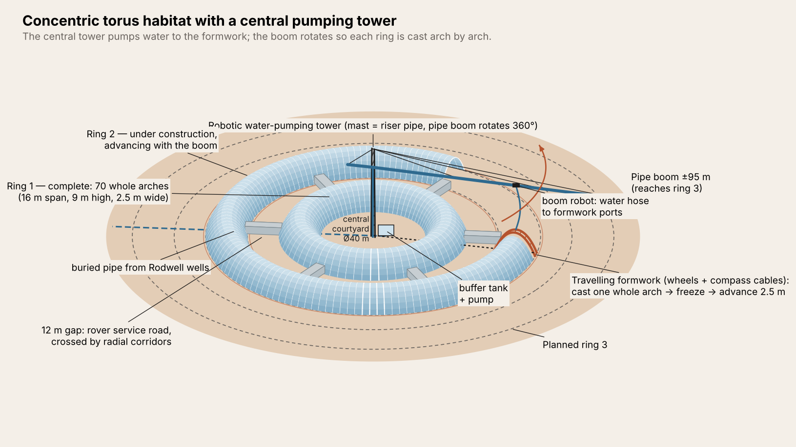
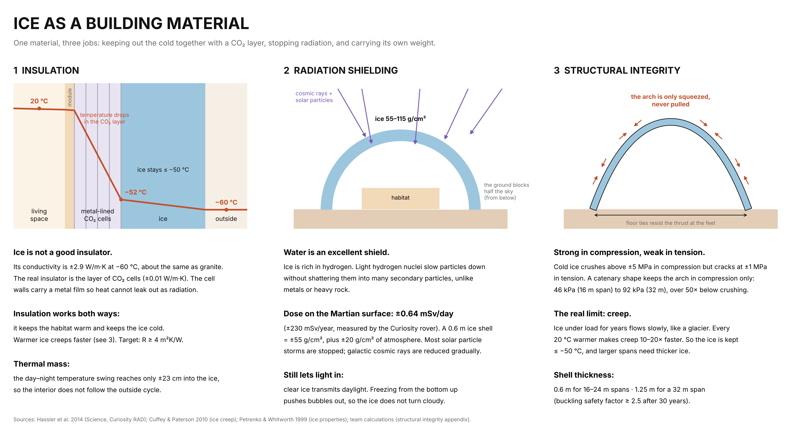
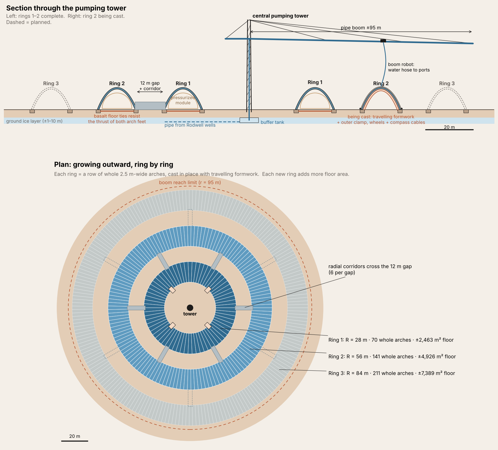
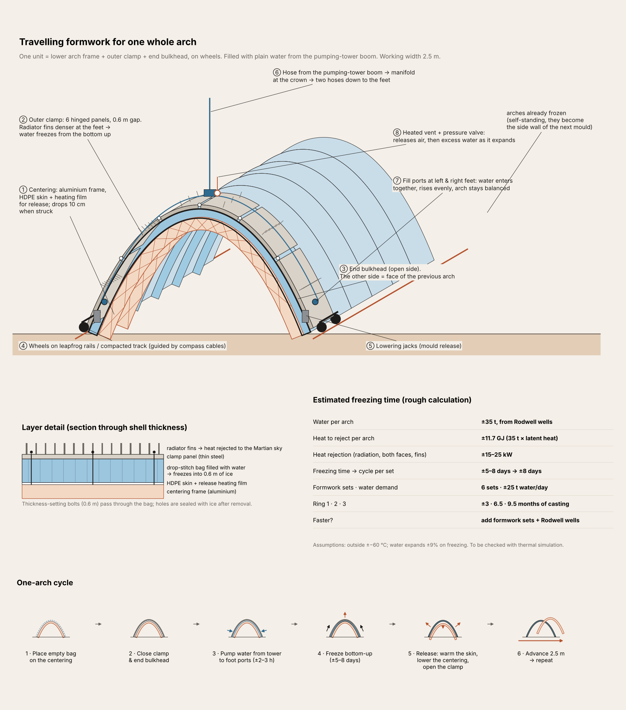
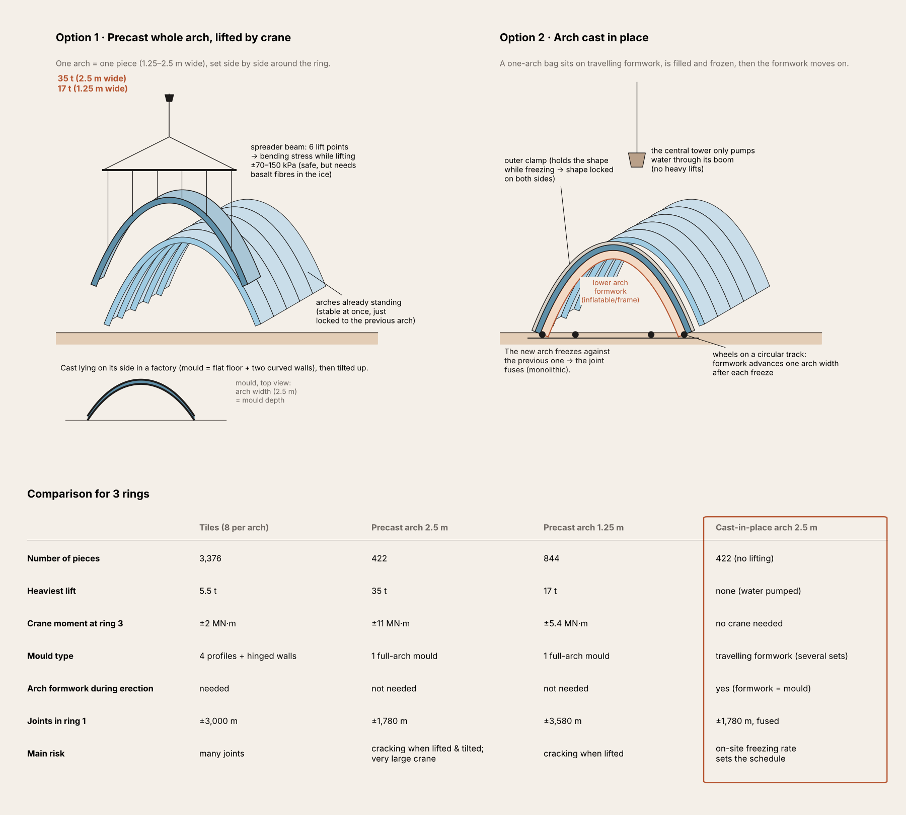
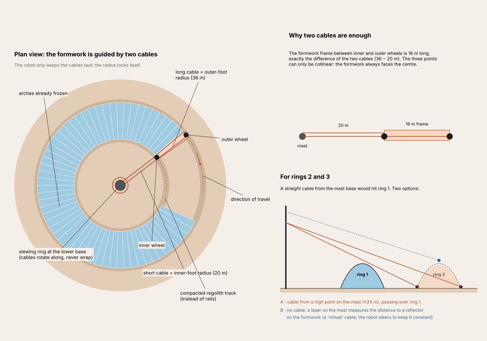
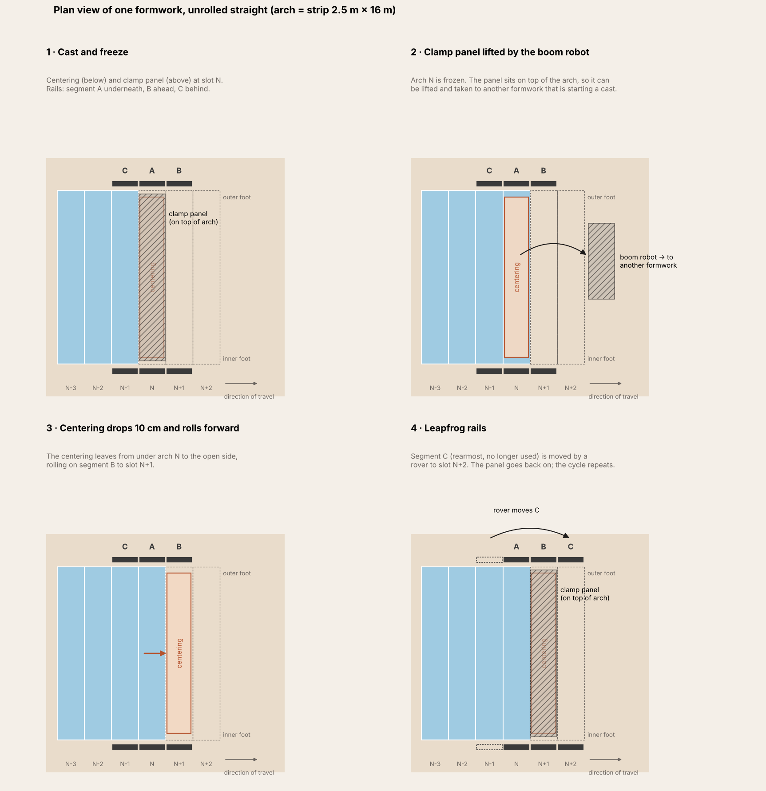
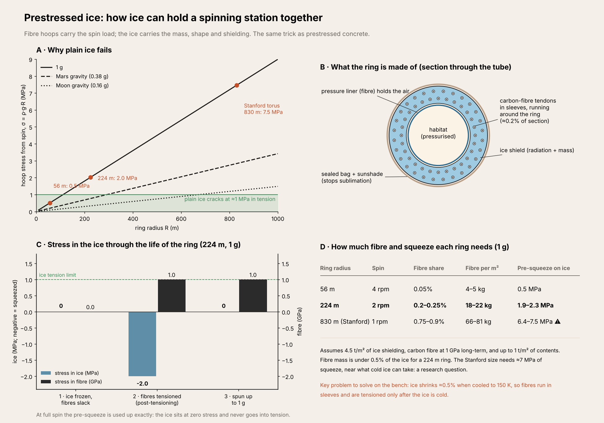
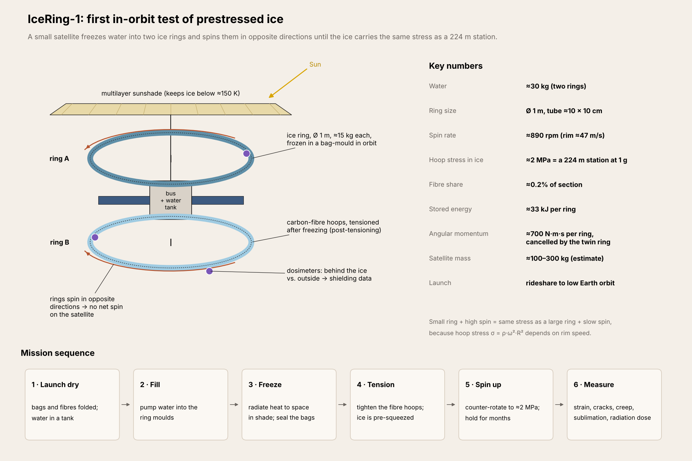

# Ice Torus

**Ice as the concrete of space.** We design habitats whose structure and radiation shield are made of water ice, frozen in place inside inflatable bag-moulds. The long-term goal is ice-shielded rotating stations built from Moon and asteroid water.



---

## Contents

1. [The problem](#the-problem)
2. [Why water ice](#why-water-ice)
3. [Why now](#why-now)
4. [Design 1: a concentric ice-ring habitat on Mars](#design-1-a-concentric-ice-ring-habitat-on-mars)
5. [Design 2: prestressed ice for rotating stations](#design-2-prestressed-ice-for-rotating-stations)
6. [Roadmap](#roadmap)
7. [Where ice fits, and where it does not](#where-ice-fits-and-where-it-does-not)
8. [Open questions](#open-questions)
9. [Repository layout](#repository-layout)
10. [Reproduce](#reproduce)
11. [References](#references)

---

## The problem

Every crewed mission beyond low Earth orbit has a radiation problem. On the Martian surface the dose is about **0.64 mSv per day** (≈230 mSv per year, measured by the Curiosity rover), and in deep space it is higher. The only reliable protection is a lot of mass, preferably hydrogen-rich, around the crew: on the order of **several tonnes per square metre** for long stays.

Today that mass is either not there (missions are kept short) or it has to be launched as rigid structure, built at full size on Earth and limited by what fits in a rocket fairing. Neither scales to people living in space.

## Why water ice

Water is already the material every crewed outpost needs for drinking, oxygen and propellant. As a building material it behaves remarkably like concrete, and in space it beats concrete on several counts.

| | Concrete on Earth | Ice in space |
| --- | --- | --- |
| Raw material | Sand, gravel, water: almost everywhere | Water: at the lunar poles, on Mars, on asteroids, on icy moons |
| How it is shaped | Liquid poured into formwork, then it cures | Liquid pumped into bag-moulds, then it freezes |
| Strength | Strong in compression, weak in tension | Same: crushes above ~5 MPa, cracks at ~1 MPa in tension |
| Fix for tension | Rebar, prestressing | Fibre hoops, post-tensioning |
| Radiation shielding | Used around reactors | Better per kilogram: hydrogen stops particles without a shower of secondaries |
| Energy to make it | Cement production is energy-hungry | Freezing is nearly free in shade: heat radiates to a ~3 K sky |
| Repair and reuse | Hard to recycle; cracks need patching | Melt and recast; cracks refreeze shut |
| Second use | None | The walls are a reserve of water, oxygen and propellant |
| Light | Opaque | Clear ice transmits daylight |



### What ice demands in return

- **It must stay cold.** Ice under sustained load flows slowly, like a glacier (creep). Every 20 °C of warming makes it creep 10–20 times faster. Creep, not melting, is what limits an ice structure.
- **It must be sealed and shaded.** In vacuum and sunlight, exposed ice sublimates. Bag-moulds keep it sealed; sunshades and reflective covers keep it below about 150 K in space.
- **Insulation goes between the warm habitat and the ice**, not outside the ice. Ice conducts heat about as well as granite (≈2.9 W/m·K at −60 °C); a layer of CO₂-filled cells (≈0.01 W/m·K) does the insulating, and the ice stays on the cold side.
- **It must only be squeezed.** Shapes are chosen so the ice is in compression everywhere: catenary arches on planets, prestressed hoops in spinning rings.

## Why now

- **Launch costs are falling by orders of magnitude.** Fully reusable heavy launch makes mass affordable for the first time, and shielding is mostly mass. Y Combinator's W27 Request for Startups, *Startups in a World of Abundant Space Access*, asks for exactly this kind of business: one that does not work at today's prices but does at 100× lower ones.
- **A meters-thick rigid shield does not fit in a fairing; water fits in any tank.** Ship it as a liquid, make the shape in place.
- **Crewed missions are heading to the water.** The first lunar bases are planned at the south pole, next to permanently shadowed ice. Mars candidate sites such as Arcadia Planitia sit on buried ice sheets.
- **Later, space water becomes cheaper than Earth water.** At station scale (millions of tonnes), lunar and asteroid water win, and the same forming technology uses them.

---

## Design 1: a concentric ice-ring habitat on Mars

**Site:** Arcadia Planitia, northern mid-latitudes, above a buried ice sheet up to ~40 m thick.

The habitat grows outward in concentric rings around a central robotic pumping tower. Each ring is a row of whole ice arches, each 2.5 m wide, cast in place one after another. Pressurised inflatable modules sit inside the arches; the ice is an unpressurised shield and shell, so it carries only its own weight.



### Key parameters

| | Ring 1 | Ring 2 | Ring 3 |
| --- | --- | --- | --- |
| Centre-line radius | 28 m | 56 m | 84 m |
| Arches (2.5 m wide) | 70 | 141 | 211 |
| Floor area | ≈2,460 m² | ≈4,930 m² | ≈7,390 m² |
| Water | ≈2,400 t | ≈4,900 t | ≈7,400 t |

Arch span 16 m, rise 9 m, ice thickness 0.6 m; 12 m service gaps between rings, crossed by radial corridors. Larger spans (24–32 m) for public spaces are analysed below.

### How it is built

1. **Water.** Rodwell wells (a proven polar technique: drill through the overburden, melt the ice underground with hot water, pump it up) supply ≈25 t of water a day. The heat comes from reactor waste heat.
2. **Pumping tower.** A central mast with a riser pipe and a rotating ±95 m pipe boom. A robot on the boom connects the hose to the formwork. There is no crane and no heavy lifting.
3. **Travelling formwork.** A centering frame below, a hinged outer clamp above, end bulkhead on the open side; the previous arch is the other side of the mould. Water fills from both feet at once, freezes from the bottom up (denser radiator fins at the feet), and a heated vent releases the 9% expansion. Then the centering drops 10 cm, rolls forward 2.5 m, and repeats.
4. **Guidance without rails.** Two cables from a slewing ring at the tower base fix each formwork to its exact radius, like a drawing compass. For outer rings a laser rangefinder replaces the cable.



| | |
| --- | --- |
|  |  |



### Structural check

`analysis/structural_integrity_EN.pdf` checks the vaults for compressive stress, Glen-law creep over 30 years, creep buckling, heat flow from the habitat, and inner-surface melting.

| Span | Ice thickness | Max. stress | Buckling FS (design) | Buckling FS (reflective cover lost) |
| --- | --- | --- | --- | --- |
| 16 m | 0.6 m | 46 kPa | 23.6 | 2.9 |
| 24 m | 0.6 m | 69 kPa | 3.3 | 0.39 |
| 32 m | 1.25 m | 92 kPa | 2.6 | 0.31 |
| 40 m | 3.4 m | 115 kPa | 2.5 | 0.37 |

Findings:

- Compressive stress is never the problem; it stays over 40× below crushing.
- Thickness is set by creep-driven buckling, which grows much faster than span.
- **Temperature is the governing variable.** With insulation of R ≥ 4 m²K/W, the inner face of the ice stays below about −50 °C. With R < 2 m²K/W, a 32 m vault slowly sags to failure long before any ice melts.
- Local melting needs a heat flux above 50–290 W/m² into the ice; panel heat takes days to weeks to cross the shell, so sensors have time to act.

---

## Design 2: prestressed ice for rotating stations

A spinning ring pulls itself apart. The hoop stress from its own weight is roughly **σ ≈ ρ·g·R**, independent of thickness:

| Ring at 1 g | Spin | Hoop stress |
| --- | --- | --- |
| R = 56 m | 4 rpm | 0.5 MPa |
| R = 224 m | 2 rpm | 2.0 MPa |
| R = 830 m (Stanford torus) | 1 rpm | 7.5 MPa |

Plain ice cracks at about 1 MPa in tension, so it cannot be the hull of a large spinning station. **Prestressed ice can.** Carbon-fibre tendons run around the ring in sleeves. After the ice is frozen and cold, they are tensioned, squeezing the ice. At full spin the squeeze is used up exactly: the ice sits at zero stress and never goes into tension.

| Ring at 1 g | Fibre share of section | Fibre per m² | Pre-squeeze on ice |
| --- | --- | --- | --- |
| 56 m | ≈0.05% | 4–5 kg | 0.5 MPa |
| 224 m | ≈0.2–0.25% | 18–22 kg | 1.9–2.3 MPa |
| 830 m | ≈0.75–0.9% | 66–81 kg | 6.4–7.5 MPa |

Assumes 4.5 t/m² of ice shielding, carbon fibre held at 1 GPa long-term, and up to 1 t/m² of contents. For a 224 m ring, the fibre is under 0.5% of the ice mass. Air pressure is carried by a separate fibre liner.



**The bench problem to solve first:** ice shrinks about 0.5% when cooled from 0 °C to 150 K, while carbon fibre barely shrinks. Bonded fibres would crack the ice, so the tendons run in sleeves and are tensioned only after the ice is cold (post-tensioning, as in prestressed concrete).

### IceRing-1

Because hoop stress depends on rim speed (σ = ρ·ω²·R²), a small, fast ring sees the same stress as a large, slow one. IceRing-1 is a proposed small-satellite test:

- two ice rings, Ø 1 m, ≈15 kg of water each, frozen in bag-moulds in orbit under a sunshade;
- post-tensioned carbon-fibre hoops;
- spun in opposite directions to ≈890 rpm, putting the ice at ≈2 MPa, the stress of a 224 m station at 1 g; the counter-rotation cancels the ≈700 N·m·s of angular momentum per ring;
- dosimeters behind the ice and outside it, for direct shielding data;
- measurements of strain, cracking, creep and sublimation over months.



Each ring stores about 33 kJ at full spin, so the satellite needs a containment shell in case a ring fails.

---

## Roadmap

| Step | What | What it proves |
| --- | --- | --- |
| 1 | **Tabletop freeze-forming test** | A water-filled bag frozen in a two-sided mould holds its shape; bottom-up freezing gives clear ice |
| 2 | **Cold spin rig** (months) | Fibre-sleeved ice rings, post-tensioned and spun to 1–3 MPa in a cold chamber; strain, cracks, creep |
| 3 | **Vacuum chamber tests** | Filling, sealing and venting at low pressure, where water boils easily; extraction from asteroid-simulant rock |
| 4 | **IceRing-1** (12–24 months) | Freezing, prestressing and spinning ice in orbit; sublimation and shielding measured |
| 5 | **Shielding products** | Ice shields for crew vehicles and habitats beyond low Earth orbit, using water launched from Earth |
| 6 | **Space water** | Ice from the lunar poles, then a pilot asteroid water factory using water as its own propellant |
| 7 | **Torus demonstrator** | An uncrewed ring a few tens of metres across, built in Earth–Moon space |
| 8 | **First crewed ring** | Smaller and at partial gravity first, then up to 1 g |

The forming, reinforcing and shielding technology stays the same at every step; only the water source and the scale change.

## Where ice fits, and where it does not

The main alternative "space concrete" is sintered or 3D-printed regolith. Regolith is available on any planetary surface; water is not. But **wherever there is water and shade, ice is the better material**: forming it means removing heat (which space does for free) rather than heating rock above 1,000 °C; it shields better per kilogram; it can be recycled and repaired; and it lets light in. That covers orbit (where there is no regolith at all), the lunar poles, Mars mid-to-high latitudes, and the asteroid belt and beyond. The two materials are largely complementary.

Ice is a poor choice near heat sources, in permanent sunlight without shading, or anywhere it would be loaded in tension without reinforcement.

## Open questions

- [ ] Strength and creep of ice held at 100–150 K under sustained compression for years (little data exists).
- [ ] Bond, friction and creep between ice and fibre sleeves through thermal cycling.
- [ ] Shape accuracy and bubble content of ice frozen in drop-stitch bags, on the ground and in microgravity.
- [ ] Sublimation rate through bag materials in vacuum, sunlight and Earth infrared.
- [ ] Real freezing time per arch on Mars, day and night; currently estimated at 5–8 days.
- [ ] Rodwell output in Arcadia ice, which may contain dust and perchlorate.
- [ ] Openings (windows, docking ports, gates) in a prestressed hoop.
- [ ] Fragment containment for spinning test rings.

## Repository layout

```
ice-torus/
├── README.md
├── requirements.txt        numpy, scipy, matplotlib
├── figures/                all figures (PNG, some SVG)
├── scripts/                code that draws every figure
│   ├── run_all.py          regenerates everything
│   └── draw2d.py           shared colour palette
└── analysis/
    ├── calc.py             structural and thermal model → results.json
    ├── make_tex_en.py      writes the LaTeX report
    ├── structural_integrity_EN.tex
    └── structural_integrity_EN.pdf
```

## Reproduce

```bash
pip install -r requirements.txt
python scripts/run_all.py                         # figures -> figures/, numbers -> analysis/
cd analysis && latexmk -pdf structural_integrity_EN.tex
```

All numbers are concept-level estimates. The structural model uses an effective-modulus buckling method and glacier-ice creep data; see the report's limitations section.

## References

- Hassler, D. M. et al. (2014). Mars' surface radiation environment measured with the Mars Science Laboratory's Curiosity rover. *Science* 343.
- Bramson, A. M. et al. (2015). Widespread excess ice in Arcadia Planitia, Mars. *Geophysical Research Letters* 42.
- Cuffey, K. M. & Paterson, W. S. B. (2010). *The Physics of Glaciers*, 4th ed. Elsevier.
- Glen, J. W. (1955). The creep of polycrystalline ice. *Proc. R. Soc. A* 228.
- Petrenko, V. F. & Whitworth, R. W. (1999). *Physics of Ice*. Oxford University Press.
- Timoshenko, S. P. & Gere, J. M. (1961). *Theory of Elastic Stability*, 2nd ed. McGraw-Hill.
- O'Neill, G. K. (1977). *The High Frontier*. William Morrow. (Stanford torus)
- Johnson, R. D. & Holbrow, C. (eds.) (1977). *Space Settlements: A Design Study*. NASA SP-413.

## Origin

The Mars ring-habitat concept was developed in the ITB course AR4155 *Topik Khusus E: Arsitektur Antariksa* (Space Architecture).
